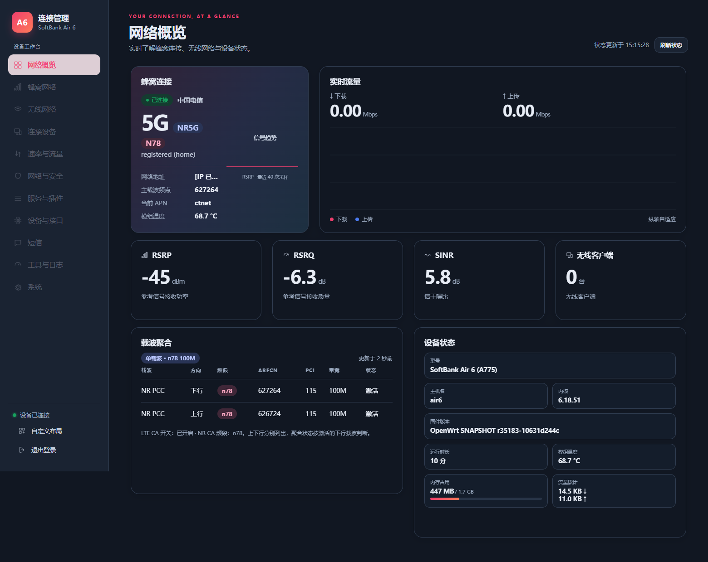
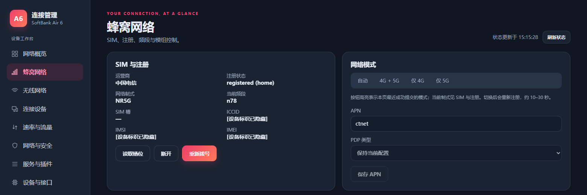
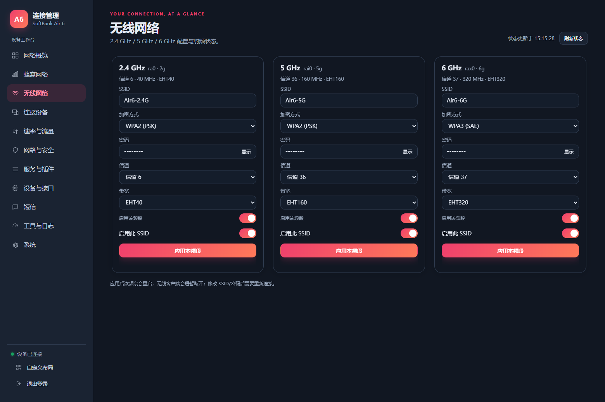
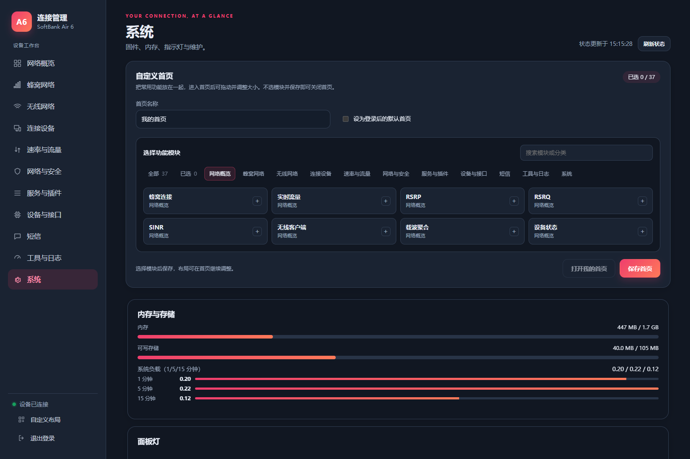

# SoftBank Air 6 / A775 — OpenWrt MT6990

**English** | [简体中文](README.zh-CN.md)

OpenWrt platform adaptation and a CPE management interface for **SoftBank Air 6 (A775)**: MediaTek MT6990 / T830, MT7990 tri-band Wi-Fi, Quectel RG620T-SBK cellular modem, and eMMC A/B slots.

## Source baseline, references and acknowledgements

This is an adaptation of existing projects, not an operating system written from scratch or an official OpenWrt support announcement. The export comes from our working `op25.12_AIR6` tree. Its earlier platform work traces back to the LG6851F / MT6990 project; AIR6 board support, vendor integration, the CPE interface and maintenance changes were added later. The current configuration uses Linux **6.18.51**, with the **6.18** kernel patch branch. The OpenWrt SNAPSHOT description must not be interpreted as an unchanged official 25.12 release tag. The public history is a grouped source import; no exact upstream Git revision equivalence is claimed.

Thanks to the following projects and contributors. The roles below reflect source files and migration records; third-party work is not presented as our original implementation.

| Source | Role in this project |
| --- | --- |
| [OpenWrt](https://github.com/openwrt/openwrt) | Build system, toolchain, base userspace, networking and package framework |
| [13179415360/openwrt-mt6990-lg6851f](https://github.com/13179415360/openwrt-mt6990-lg6851f) | Initial MT6990 / T830 engineering and LG6851F platform reference, subsequently adapted for AIR6 |
| [ImmortalWrt MT798x rebase / chasey-dev](https://github.com/chasey-dev/immortalwrt-mt798x-rebase) | MediaTek platform, acceleration and wireless implementation references; not a claim that its entire configuration is used |
| [Linux](https://www.kernel.org/) and original [MediaTek](https://www.mediatek.com/) implementations | Kernel, MT6990/MT7990 drivers, HNAT/WED and platform interfaces; original notices remain applicable |
| [Quectel](https://www.quectel.com/) SDK interfaces | Cellular MIPC, dialing and vendor userspace interfaces; the complete SDK, signing tools and keys are excluded |
| [LuCI](https://github.com/openwrt/luci) | Administration interface, rpcd/ubus integration and packages |
| [Vue](https://github.com/vuejs/core) | Reactive CPE interface; bundled header identifies v3.5.45, MIT |
| [GridStack](https://github.com/gridstack/gridstack.js) | Dashboard dragging, resizing and grid layout; retain its license |
| [QWRT / coolsnowwolf](https://github.com/coolsnowwolf/qwrt) | Reference leads during encrypted Wi-Fi troubleshooting; the retained fix is the hostapd RSN replay-counter patch, not every experimental patch |
| Online CPE management interfaces | The UI was rewritten independently, with design references from various CPE management interfaces available online |

The excluded `mtwifi-cfg-tool` files identify oraybox, StarField Xu and other contributors, with GPL notices. Thanks for their wireless management work. Excluding that package does not change its original license.

### Pinned feeds

The build uses the root [feeds.conf](feeds.conf):

| Feed | Repository | Revision |
| --- | --- | --- |
| packages | [openwrt/packages](https://github.com/openwrt/packages) | `aea49e65a439f73fbc0e4b8c60ced1f1839f64fd` |
| luci | [openwrt/luci](https://github.com/openwrt/luci) | `e969939b49167516e219d465df8030d98d443d67` |
| routing | [openwrt/routing](https://github.com/openwrt/routing) | `48c808034414a2112cf9d5261a20a320e8d0d170` |
| telephony | [openwrt/telephony](https://github.com/openwrt/telephony) | `c58ec5a6703966dcccb53d0919698c8aba3a9ef5` |

## Included and excluded components

Included: AIR6 platform adaptation, MT7990 driver sources, cellular integration, CPE dashboard, carrier display, merged device status, tri-band settings, custom homepage, SMS/tools, automatic APN correction and authenticated direct uploads with complete signature/image verification.

The original private repository is preserved. Its old Git history is not imported. This export excludes production APK/update private keys, vendor signing SDKs, private signing scripts, the device-authorization modem runtime, the original root password hash, and **`package/mtk/mtwifi-cfg-tool`**.

The excluded package supplies the mtwifi daemon and its netifd management integration. Its default package selection is disabled. A compatible independent implementation or separately installed component is needed to reproduce the private reference system's wireless management. Screenshots show a reference system with that component installed; they do not prove this reduced tree provides identical functionality.

## Wireless management: help build a maintainable replacement

`mtwifi-cfg-tool` bridges the vendor `mt_wifi` driver and OpenWrt administration. It is neither the cellular modem utility nor the Wi-Fi chip driver itself. Only its responsibilities and interface requirements are documented here; its source and package recipe are excluded.

Its responsibilities are:

1. Parse and validate UCI radio/BSS settings from `/etc/config/wireless`.
2. Synchronize a common wireless model with vendor `.dat` profiles, including band, channel, width and SSID settings.
3. Generate/apply hostapd configuration for options such as WPA2/WPA3, PMF and WMM; configuration alone does not establish client compatibility.
4. Expose a `mtwifi` ubus service with operations such as `up`, `down`, `config`, `status`, `band`, `reset` and `log`.
5. Integrate netifd setup/teardown and service startup so LuCI/CPE controls can manage radios and multiple SSIDs.

Contributors are welcome to develop an independently maintainable, openly licensed compatible implementation. Start with interface design and a minimal radio/BSS lifecycle, then test reboot, reload, tri-band behavior, multiple SSIDs, password changes, WPA/PMF compatibility and rollback. Do not assume permission to redistribute the excluded implementation. Coordinate through Issues / Pull Requests. Building the MT7990 driver alone does not provide this complete management layer.

## Build from source

Build on a Linux filesystem, for example WSL2 `~/src`, rather than `/mnt/c` or `/mnt/x`. Consult the [official OpenWrt build requirements](https://openwrt.org/docs/guide-developer/toolchain/install-buildsystem).

### 1. Install dependencies (Ubuntu / Debian)

```bash
sudo apt update
sudo apt install -y build-essential clang flex bison g++ gawk gcc-multilib \
  gettext git libncurses-dev libssl-dev python3 python3-setuptools \
  rsync unzip zlib1g-dev file wget curl libelf-dev zstd squashfs-tools
```

### 2. Clone and install pinned feeds

```bash
mkdir -p ~/src
cd ~/src
git clone https://github.com/hchyhchyxh/openwrt-air6.git
cd openwrt-air6
./scripts/feeds update -a
./scripts/feeds install -a
make defconfig
```

While this preparation repository is private, cloning requires your own GitHub access. The configured target is `mediatek/mt6990/softbank_air6`. Use `make menuconfig` to change features. Do not select `mtwifi-cfg-tool` unless you independently supply that component.

### 3. Compile

```bash
make download -j4
make -j"$(nproc)"
```

For a failure, retain a verbose serial log:

```bash
make -j1 V=s 2>&1 | tee build.log
```

### 4. Inspect artifacts

```text
bin/targets/mediatek/mt6990/
├── openwrt-mediatek-mt6990-softbank_air6-squashfs-boot.img
├── openwrt-mediatek-mt6990-softbank_air6-squashfs-rootfs.img
└── rootfs.img
```

These are development artifacts. **Vendor secure boot requires a compatible boot signature; an ordinary build is not a signed, ready-to-flash release.** Automatic private release signing hooks were removed. This tree does not generate packages signed with the original release identity. The current MT6990 flow does not add a separate vendor rootfs signature; release-package authentication remains an independent maintainer responsibility.

APK signing uses your own build identity. For the web updater, supply your own trusted public key at `package/hcy/air6-cpe-ui/files/etc/air6-cpe/update.pub`. Verification remains mandatory; updates are rejected without a trust key. Existing production devices continue to trust their original release identity and do not automatically trust new keys.

### 5. Validation limits

The export was checked for source contents, sensitive material, selected script syntax and the running reference UI. A complete clean build of this reduced tree has not been performed, and it has not been flashed. Private-system tests are not acceptance tests for this export without its excluded signing and wireless-management components.

## Usage and contribution

Open the gateway address obtained through DHCP and configure your own login password. In the cellular page, configure SIM/mode/APN and verify registration, an assigned data address and external connectivity. Saving a custom homepage with zero modules disables it; other layouts can be adjusted from the homepage.

Related project: [AIR6 modem metadata research](https://github.com/hchyhchyxh/air6-modem).

Retain [COPYING](COPYING), [LICENSES](LICENSES) and file-level notices. OpenWrt, Linux, drivers, SDK interfaces, third-party JavaScript and firmware retain their respective licenses. This export does not relicense everything under one license. Contributions to board support, wireless compatibility, cellular stability and documentation are welcome; include a revision and redacted reproduction logs.

## Reference screenshots — November 8, 2026

Captured after real China Telecom **5G n78** registration and data connectivity. Device identifiers and addresses are redacted. These images demonstrate the private reference system's UI, not device validation of the unsigned public modem experiment or feature equivalence of the reduced OpenWrt tree.

### Network overview: 5G n78 and a 100 MHz carrier



### Cellular: SIM registration, network mode and APN



### Tri-band wireless settings



### System and custom homepage


