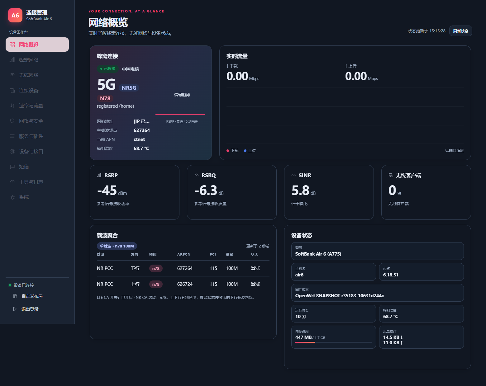
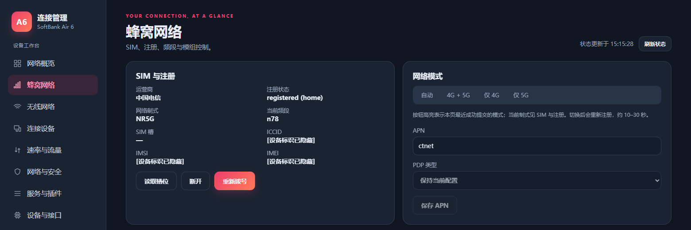
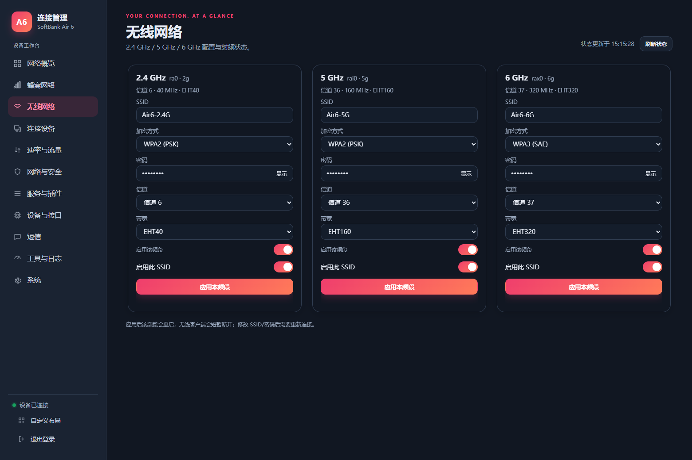
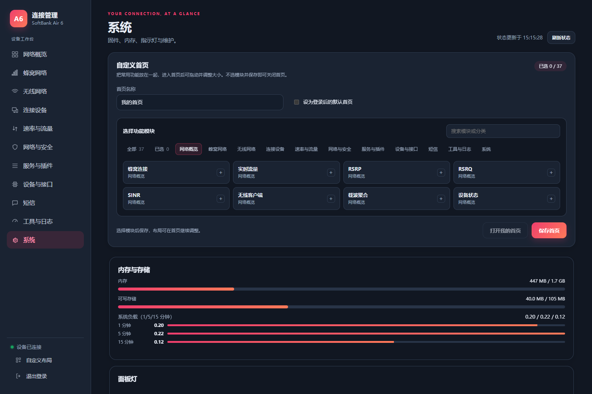

[English](README.md) | **简体中文**

# SoftBank Air 6 (软银 Air6 / A775) — OpenWrt MT6990

面向日本软银家用路由器 **SoftBank Air 6（软银 Air6，型号 A775）** 的 OpenWrt 适配与 CPE 管理界面。SoC 为 MediaTek MT6990 / T830，无线为 MT7990 三频，蜂窝模组为移远 RG620T-SBK，使用 eMMC A/B 槽。

## 源码基线、参考与致谢

这不是从零编写的操作系统，也不是官方 OpenWrt 对 AIR6 的支持声明。本副本从本项目现用 `op25.12_AIR6` 工作树整理，原始工程历史可追溯到 LG6851F / MT6990 适配，随后加入 AIR6 板级移植、原厂驱动链、CPE UI 和维护改动。当前配置使用 Linux **6.18.51**，内核补丁分支 **6.18**；界面中的 OpenWrt SNAPSHOT 版本描述不应理解为一个原封不动的官方 25.12 发布标签。公开整理重新组织了提交，未伪造与某个上游 Git SHA 一一对应的历史。

感谢以下项目、开发者及贡献者。用途按现有代码和移植记录标注，不能把全部第三方工作归为本项目原创：

| 来源 | 在本工程中的用途 |
| --- | --- |
| [OpenWrt](https://github.com/openwrt/openwrt) | 构建系统、工具链、基础用户空间、网络与软件包框架 |
| [13179415360/openwrt-mt6990-lg6851f](https://github.com/13179415360/openwrt-mt6990-lg6851f) | 基础 MT6990 / T830 工程、LG6851F 平台适配参考；本项目在其相关工程基础上继续移植 AIR6 |
| [ImmortalWrt MT798x rebase / chasey-dev](https://github.com/chasey-dev/immortalwrt-mt798x-rebase) | MediaTek 平台、加速和无线实现参考，不代表完整采用其默认配置 |
| [Linux kernel](https://www.kernel.org/) 与 [MediaTek](https://www.mediatek.com/) 原有实现 | 内核、MT6990/MT7990 驱动、HNAT/WED 与平台接口；保留文件内原作者及许可 |
| [Quectel 移远通信](https://www.quectel.com/) SDK 相关接口 | 蜂窝 MIPC/拨号与厂商用户空间接口；整套 SDK、厂商签名工具与密钥不随本副本提供 |
| [OpenWrt LuCI](https://github.com/openwrt/luci) | LuCI 管理界面、rpcd/ubus 集成及相关软件包 |
| [Vue](https://github.com/vuejs/core) | CPE 页面响应式 UI，当前自带构建头标注 v3.5.45，MIT |
| [GridStack](https://github.com/gridstack/gridstack.js) | 卡片拖动、缩放与栅格布局，保留其许可 |
| [QWRT / coolsnowwolf](https://github.com/coolsnowwolf/qwrt) | 加密 Wi-Fi 兼容性排查时的参考线索；最终修复见本库 hostapd RSN replay-counter 补丁，不把未保留的实验补丁算作已移植功能 |
| 网上一些 CPE 管理界面 | 参考网上一些 CPE 的管理界面，自行重写了 UI |

`mtwifi-cfg-tool` 的原文件注明 oraybox、StarField Xu 等作者及 GPL 许可。本开源副本按维护者要求不包含这个包；感谢原作者的无线管理工作，移除包不改变其原许可。

### 固定 feeds

实际构建优先使用根目录 [feeds.conf](feeds.conf)，目前固定如下提交：

| Feed | 仓库 | 提交 |
| --- | --- | --- |
| packages | [openwrt/packages](https://github.com/openwrt/packages) | `aea49e65a439f73fbc0e4b8c60ced1f1839f64fd` |
| luci | [openwrt/luci](https://github.com/openwrt/luci) | `e969939b49167516e219d465df8030d98d443d67` |
| routing | [openwrt/routing](https://github.com/openwrt/routing) | `48c808034414a2112cf9d5261a20a320e8d0d170` |
| telephony | [openwrt/telephony](https://github.com/openwrt/telephony) | `c58ec5a6703966dcccb53d0919698c8aba3a9ef5` |

## 本副本包含什么

- AIR6 平台适配、MT7990 驱动源码、蜂窝拨号与状态查询。
- 网络概览、载波聚合显示、合并设备状态、三频无线配置、自定义首页、短信和工具页面。
- 自动 APN 的 SIM/PLMN 检查与修正、需要认证的文件直传上传、完整签名和镜像哈希校验。

原私有仓库保留；本副本没有带入其旧 Git 历史。**不包含**生产 APK/更新包私钥、SDK 签名工具、私有签发脚本、一机一码 modem 运行时、原设备 root 密码哈希和 `package/mtk/mtwifi-cfg-tool`。

`mtwifi-cfg-tool` 的包源码、编译配方、mtwifi daemon/netifd 管理集成没有提供，默认取消选择。要获得与私有参考系统一致的无线管理能力，需要自行提供兼容实现或独立安装该组件。截图里的参考系统已安装该组件，不能据此声称这个裁剪源码可直接复现同等功能。

## 无线管理组件接力：欢迎实现可公开维护的兼容版

`mtwifi-cfg-tool` 是厂商无线驱动与 OpenWrt 管理层之间的适配组件，不是蜂窝 modem 工具，也不是 Wi-Fi 芯片驱动本身。本副本只保留用途和接口说明，源码、包配方与原实现文件均不提供。

它原来承担以下工作：

1. 读取 `/etc/config/wireless` 的 UCI radio / BSS 配置并做绑定和校验。
2. 将通用无线模型与厂商 `.dat` profile 同步，处理频段、信道、带宽、SSID 等设置。
3. 生成并应用 hostapd 配置，衔接 WPA2/WPA3、PMF、WMM 等选项；设置并不等于终端兼容性已验证。
4. 通过 `mtwifi` ubus 服务向上提供 `up`、`down`、`config`、`status`、`band`、`reset`、`log` 等操作。
5. 对接 netifd 无线 setup/teardown 和服务启动，使 LuCI/CPE UI 能控制厂商驱动下的射频及多 SSID 生命周期。

欢迎愿意接手的开发者从这些接口需求出发，实现一个许可清晰、可独立公开维护的兼容替代层。可以沿用上层 UCI/ubus 约定，但不要默认拥有被排除实现的再发布授权。建议先提交接口设计和最小 radio/BSS 生命周期，再测试重启、热重载、三频、多 SSID、密码变更、WPA/PMF 兼容及失败回滚。贡献可通过本仓库 Issues / Pull Requests 协作。

在替代层完善前，不能把单独编译出 MT7990 驱动等同于已经具备完整的无线配置和启停管理能力。

## Build：从源码构建

建议在 Linux 文件系统目录下构建，例如 WSL2 的 `~/src`，不要在 `/mnt/c`、`/mnt/x` 中编译。依赖说明以 [OpenWrt 官方构建文档](https://openwrt.org/docs/guide-developer/toolchain/install-buildsystem) 为准。

### 1. 安装依赖（Ubuntu / Debian）

```bash
sudo apt update
sudo apt install -y build-essential clang flex bison g++ gawk gcc-multilib \
  gettext git libncurses-dev libssl-dev python3 python3-setuptools \
  rsync unzip zlib1g-dev file wget curl libelf-dev zstd squashfs-tools
```

### 2. 获取工程与固定 feeds

```bash
mkdir -p ~/src
cd ~/src
git clone https://github.com/hchyhchyxh/openwrt-air6.git
cd openwrt-air6
./scripts/feeds update -a
./scripts/feeds install -a
make defconfig
```

当前仓库暂为私有时，克隆需要你自己的 GitHub 权限；公开后可匿名读取。根目录 `.config` 的目标为 `mediatek/mt6990/softbank_air6`。需要修改功能时运行 `make menuconfig`。不要在未单独提供源码的情况下重新选中 `mtwifi-cfg-tool`。

### 3. 编译

```bash
make download -j4
make -j"$(nproc)"
```

失败后保留详细日志重试，便于区分依赖下载、内核编译或软件包错误：

```bash
make -j1 V=s 2>&1 | tee build.log
```

### 4. 检查产物

```text
bin/targets/mediatek/mt6990/
├── openwrt-mediatek-mt6990-softbank_air6-squashfs-boot.img
├── openwrt-mediatek-mt6990-softbank_air6-squashfs-rootfs.img
└── rootfs.img
```

这些是开发构建产物。**厂商安全启动需要兼容的 boot 签名，普通编译产物不是已完成签名的可直接刷机发行包。** 本副本移除了自动签发钩子，不会自动产生原私有身份签名的后台升级包。rootfs 按现有 MT6990 工程流程不额外附加厂商签名；发布包层面的镜像认证仍然需要维护者自己的流程。

APK 构建签名使用构建者自己的密钥，原私钥没有公开。Web 更新仍强制验签：若要使用，需要自行把维护者信任公钥放到 `package/hcy/air6-cpe-ui/files/etc/air6-cpe/update.pub`；未配置时拒绝更新，不能通过关闭验签处理。原发行设备仍信任原发布身份，不会自动信任其他新密钥。

### 5. 已完成的验证边界

本次公开整理检查了源码/文件清单、敏感材料、指定脚本语法及运行中参考系统的 UI；没有在裁剪副本执行一次从零全量编译，也没有刷入这个去签名、去无线管理组件的副本。私有系统的运行测试不等同于公开副本完整验收。

## 使用

从电脑 DHCP 获得的网关地址进入管理页，设置自己的登录密码。蜂窝页配置 SIM、模式、APN，注册成功且数据连接取得地址后再检查外网。自定义首页已选 0 并保存会关闭；其余布局可在首页调整。

相关项目：[AIR6 modem 元数据实验](https://github.com/hchyhchyxh/air6-modem)。

## 许可与贡献

保留 [COPYING](COPYING)、[LICENSES](LICENSES) 和各文件的原有版权/许可证。OpenWrt、Linux、驱动、SDK 接口、第三方 JS 与固件分别遵循自己的许可；本次整理不会把整套代码重新许可成单一许可证。欢迎提交 AIR6 板级适配、Wi-Fi 兼容、蜂窝稳定性及文档改进，复现问题请附去标识化日志与提交号。

## 实机界面展示（2026-11-08）

以下为 AIR6 私有参考系统在真实电信 5G n78 注册、数据连接成功后采集的界面，设备标识与地址已遮蔽。界面截图用于展示操作体验；不代表本仓库未签名实验构建已经获得相同的真机验证。

### 网络概览：5G n78 与 100 MHz 载波



### 蜂窝网络：SIM 注册、网络模式与 APN



### 三频无线网络设置



### 系统与自定义首页



